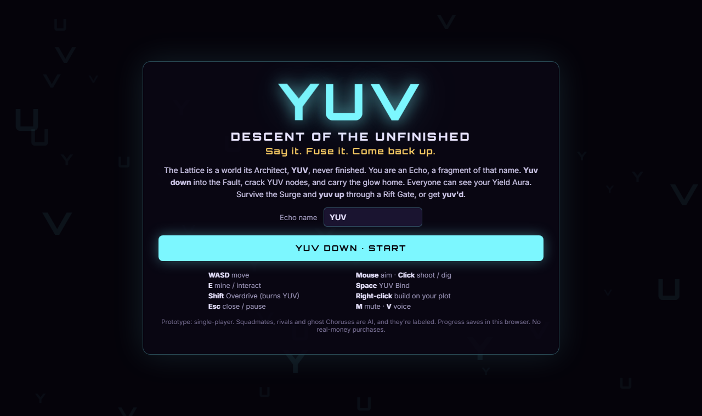
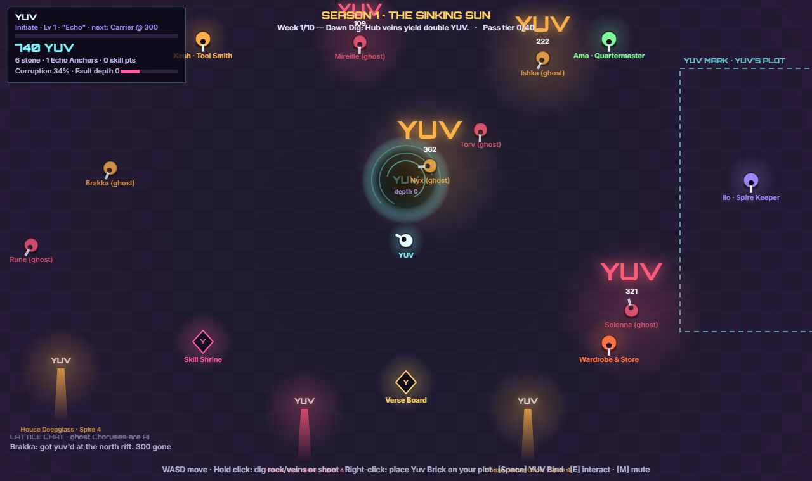
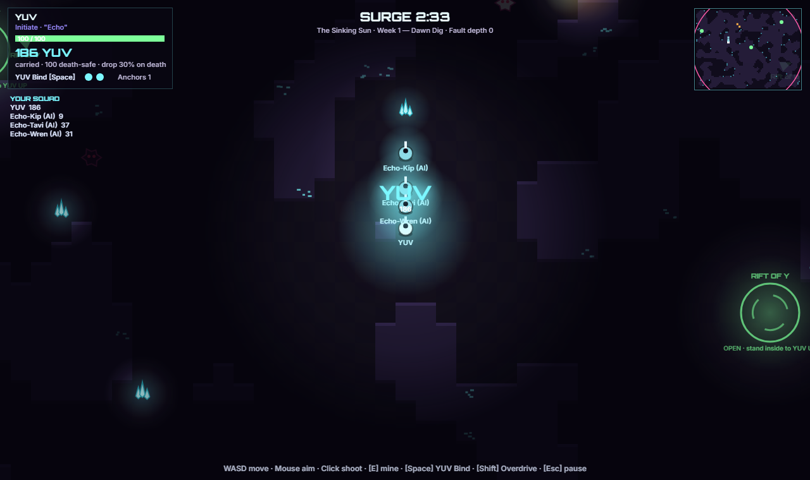

# YUV: Descent of the Unfinished

> **Say it. Fuse it. Come back up.**

A browser game prototype. You're an Echo, a fragment of **YUV**, the Architect who never finished the world.
**Yuv down** into the Fault and crack glowing YUV nodes. Everyone can see your haul floating over your head.
Survive rival squads, Hollows and the closing Surge, then **yuv up** through a Rift Gate before you get **yuv'd**.

**▶ Play:** https://xnestoris.github.io/yuv-descent/ (or open `index.html` locally, no build step)



| The Lattice hub | A dive into the Fault |
|---|---|
|  |  |

## How to play

| Key | Action |
|---|---|
| **WASD / arrows** | Move |
| **Mouse + click** | Aim and shoot. In the hub, hold click on rock or veins to dig |
| **E** | Mine a YUV node / interact with stations |
| **Space** | **YUV Bind**: shout the name to blast rock and enemies. Nearby squadmates join for a **Chorus Bind** |
| **Shift** | **Yuv Overdrive**: sprint by burning the YUV you carry |
| **Right-click** | Place Yuv Bricks on your plot (costs stone) |
| **Esc** | Close panel / pause |
| **M / V** | Mute sound / toggle the spoken "YUV!" voice |

### The loop
1. **Hub (the Lattice).** Dig rock for stone and veins for YUV. Overmining spreads **Corruption**, which spawns Hollows that raid your hub, but it also **deepens the Fault** so dives get richer and harder. Build on your plot, raise your **Spire**, and buy gear from Kesh and Ama.
2. **Dive (the Fault).** You and 3 Echo AI squadmates take on 2 rival squads and the Hollows.
   - Crack nodes and scoop the glow.
   - Your **Yield Aura** and floating **YUV glyph** grow with your haul. Rivals and Hollows notice, and you slow down.
   - The **Surge** ring closes in. Stand in an open **Rift Gate** to **YUV UP**.
3. **Die and you get yuv'd.** You drop part of your unsafe haul for others to steal. A new-player safety net applies: 30% drop rising to 70% over your first 10 dives, a death-safe first 100 YUV below Carrier rank, and Echo Anchors.
4. **Progress.**
   - Levels 1–40 and two skill trees (Delver and Warden).
   - Ranks from Initiate to **YUV Prime**.
   - A 40-tier season pass with auras and titles.
   - The **YUV Wall** leaderboard.
5. **Seasons.** Each season runs on a 10-week **Verse** with a modifier every week. A dive in week 10 triggers **The Unwriting**: the Wall is carved into Y-Sigils, a 30% Tithe is taken above your Spire vault, and a new Verse begins.

### Where YUV shows up
- The core resource and currency.
- Verbs: *yuv down*, *yuv up* and *yuv'd* (the death screen).
- The **YUV Bind** and Chorus Bind.
- The **Yield Aura** glyph.
- The **YUV Wall** and the **YUV Prime** rank.
- Every Spire's crown.
- The Fault's heart.
- Briefings from YUV the Architect.
- The season finale, **The Unwriting**.

## Prototype notes
- Single-player. Squadmates (`Echo-… (AI)`), rival squads and hub "ghost Choruses" are AI, and they're labeled in-game.
- Progress saves to `localStorage` in your browser.
- **No real-money purchases.** The Y-Shard store and the premium pass track show the planned cosmetic-only price points, but buying is disabled.
- Built with plain HTML5 Canvas and JavaScript, with no dependencies and no build step.

## Development
```
index.html        page shell
css/style.css     UI panels
js/core.js        input, sound, save
js/data.js        ranks, Verse weeks, pass, skills, lore
js/world.js       grid, cave generation, pathfinding, drawing helpers
js/hub.js         the Lattice hub
js/dive.js        extraction dives, AI, Surge, YUV Bind
js/ui.js          HTML panels
js/main.js        game loop, progression, self-test
```
Open `index.html#selftest` to run a headless smoke test. It runs six autopilot dives, a season Unwriting and every panel, and the result is written to `body[data-selftest]`.

## Roadmap (post-prototype)
Based on the design review's MVP cut list:
- Citadels and siege windows.
- Skill trees 3–5.
- Prestige (Y-Glyphs).
- The live Grand Surge.
- A creator workshop.
- World-scale terraforming.
- Real multiplayer with server-authoritative dives.
